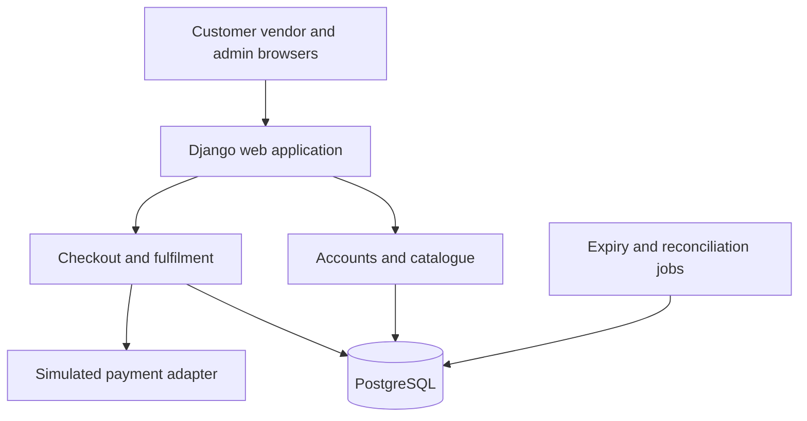

# Multi-Vendor E-Commerce Platform

A proposed marketplace where multiple approved vendors sell through one catalogue. Customers place a consolidated order, vendors fulfil their own suborders, and administrators manage approvals and commission reporting.

**Current stage: requirements and design.** This repository contains Software Design Principles experiments, analysis diagrams and a Python starter entry point. It does not yet contain a working e-commerce application.

## Student Details
| Field | Value |
|---|---|
| Name | Keshav Garg |
| Roll number | 202401100600102 |
| Class and session | IT-B, 2026-27 |
| Project | Multi-Vendor E-Commerce Platform |

## Planned Core Features
1. Customer, vendor and administrator accounts with server-side access control.
2. Vendor approval and management of each vendor's own products and stock.
3. Search, category filters and a mixed-vendor cart.
4. Atomic checkout with stock reservation, a parent order and vendor suborders.
5. Simulated or sandbox payment flow with idempotent event processing.
6. Separate fulfilment tracking for each vendor.
7. Commission snapshots and administrative reports, without real payouts.
8. Reviews restricted to delivered purchases and audit logs for sensitive actions.

## Architecture


The application is planned as a modular monolith. Checkout commits the reservation before contacting the payment adapter. Payment success consumes a reservation; failure or expiry releases it exactly once. Vendors can access only their own records.

## Proposed Technology Stack
| Layer | Technology | Status |
|---|---|---|
| Language | Python 3.12 or later | Starter configured |
| Web framework | Django | Planned |
| UI | Django templates, HTML, CSS, JavaScript | Planned |
| Database | PostgreSQL | Planned |
| Payments | Simulated adapter then selected sandbox | Planned |
| Tests | Python unittest and Django test framework | Planned |
| Version control | Git and GitHub | Repository structure prepared |

## Team and Module Allocation
| Member | Roll number | Proposed responsibility |
|---|---|---|
| Keshav Garg | 202401100600102 | Repository setup, documentation and integration |
| Mohit Singh | 202401100600115 |  Accounts, vendor approval and permissions |
| Ritik Goel  | 202401100600144 |  Catalogue, search and stock management |
| Gaurav Verma| 202401100600081 | Checkout, payment state and fulfilment |
| Prashant    | 202401100600129 | Fulfilment, Reviews and Testing  |

This is a suggested four-person allocation; membership and final responsibilities need confirmation. Do not assign commits or completed work to unconfirmed members.

## Lab Documentation
| Experiment | Topic | GitHub version | Word version |
|---|---|---|---|
| 2 | Problem identification and feasibility | [Markdown](experiments/Experiment_2.md) | [Word](experiments/Experiment_2.docx) |
| 3 | Requirement gathering and user stories | [Markdown](experiments/Experiment_3.md) | [Word](experiments/Experiment_3.docx) |
| 4 | Software Requirements Specification | [Markdown](experiments/Experiment_4.md) | [Word](experiments/Experiment_4.docx) |

## Analysis Models
- [Context DFD](docs/diagrams/model1_context_dfd.png)
- [Level 1 DFD](docs/diagrams/model2_level1_dfd.png)
- [Use cases](docs/diagrams/model3_use_case.png)
- [Core ER model](docs/diagrams/model4_er_diagram.png)
- [Checkout sequence](docs/diagrams/model5_sequence.png)

Editable Mermaid source is stored beside every PNG. The diagrams describe the target design, not implemented functionality.

## Repository Structure
- `experiments/`: Experiments 2–4 in Markdown and Word.
- `docs/diagrams/`: Five rendered diagrams and editable Mermaid sources.
- `src/multivendor/`: Starter package and planned module boundaries.
- `test/`: Acceptance checklist; application tests remain to be implemented.
- `main.py`: Runnable starter; no server or payment processing.
- `pyproject.toml`: Python project metadata with no third-party runtime dependencies yet.
- `.env.example`: Proposed local configuration; no real credentials.

## Getting Started
```bash
git clone https://github.com/KeshavGarg2570/2026-27_IT_B_202401100600102.git
cd 2026-27_IT_B_202401100600102
python main.py
```
Use `python3` instead of `python` if required by your system. Python 3.12 or later is recommended. The command prints project information; it does not launch a store. Django and PostgreSQL setup instructions will be added alongside their actual implementation.

## Business Rules
- Prices use integer paise; rates use basis points. Product subtotal excludes shipping, tax and discounts in the demo.
- A single checkout creates one parent order and one suborder per vendor.
- Available stock is reserved atomically; repeated callbacks never decrement or release twice.
- Vendor ownership and approval are revalidated on the server.
- Order item prices and commission rates are immutable snapshots.
- Unpaid or reconciliation-flagged orders cannot be fulfilled.

## Suggested Branching and Collaboration
Use `main` for reviewed baseline work and `feature/<module>-<task>` for implementation. Each contributor should use their own account and commit only their actual work. Open pull requests with relevant test evidence. These are workflow guidelines; additional remote branches and reviews have not been created automatically.

## Status
- [x] Repository content and starter structure prepared
- [x] Experiment 2: problem and feasibility
- [x] Experiment 3: proposed requirements and stories
- [x] Experiment 4: SRS and analysis diagrams
- [ ] Confirm group members and stakeholder requirements
- [ ] Accounts and vendor approval
- [ ] Catalogue, cart and inventory
- [ ] Transactional checkout and payment adapter
- [ ] Dashboards, fulfilment and reviews
- [ ] Acceptance tests and deployment

## Scope and Integrity
This is an academic prototype plan. Interviews and performance results are not fabricated; planned tests are labelled accordingly. Live payment collection, payouts, courier integrations and production operations are outside the current release.

## Reference and License
The lab-document organisation was informed by the [reference repository](https://github.com/IshwarRajChauhan/2026-27_IT-B_202401100600094). Marketplace prose and diagrams are newly prepared for this project; the reference project's code, personal details and contribution history have not been copied. A source-code license will be selected by the team before external reuse is authorised.
