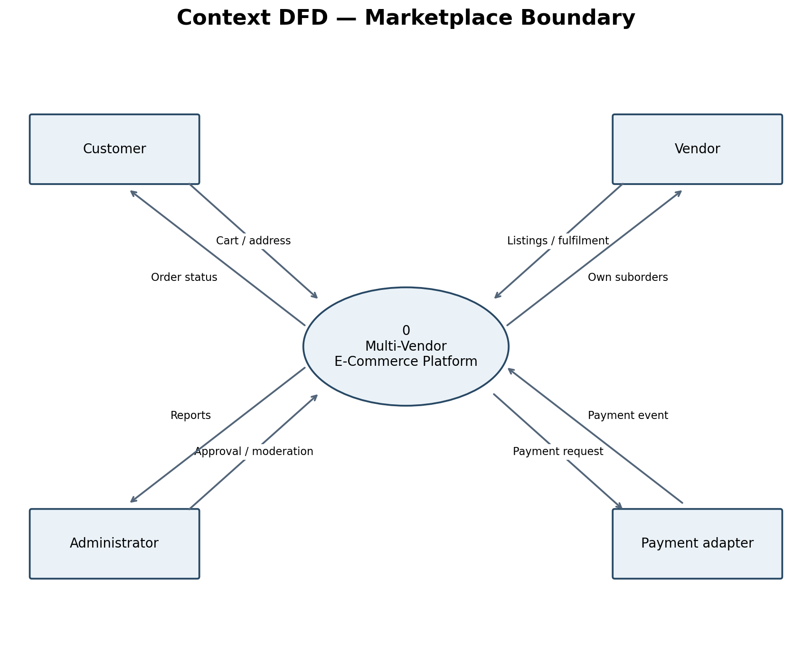
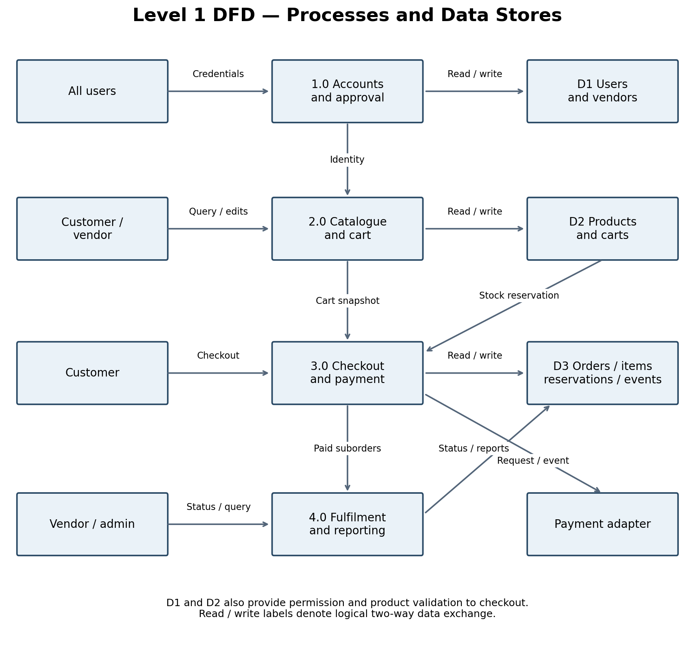
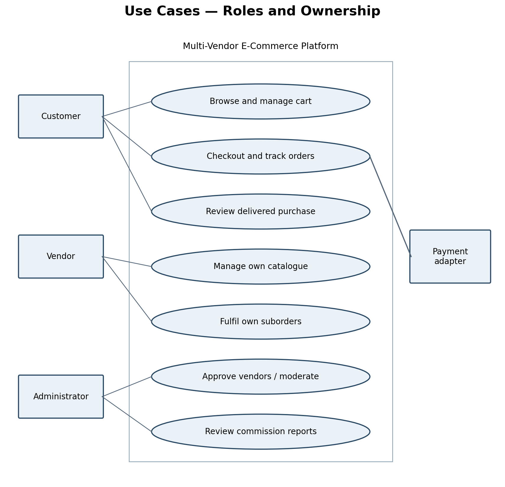
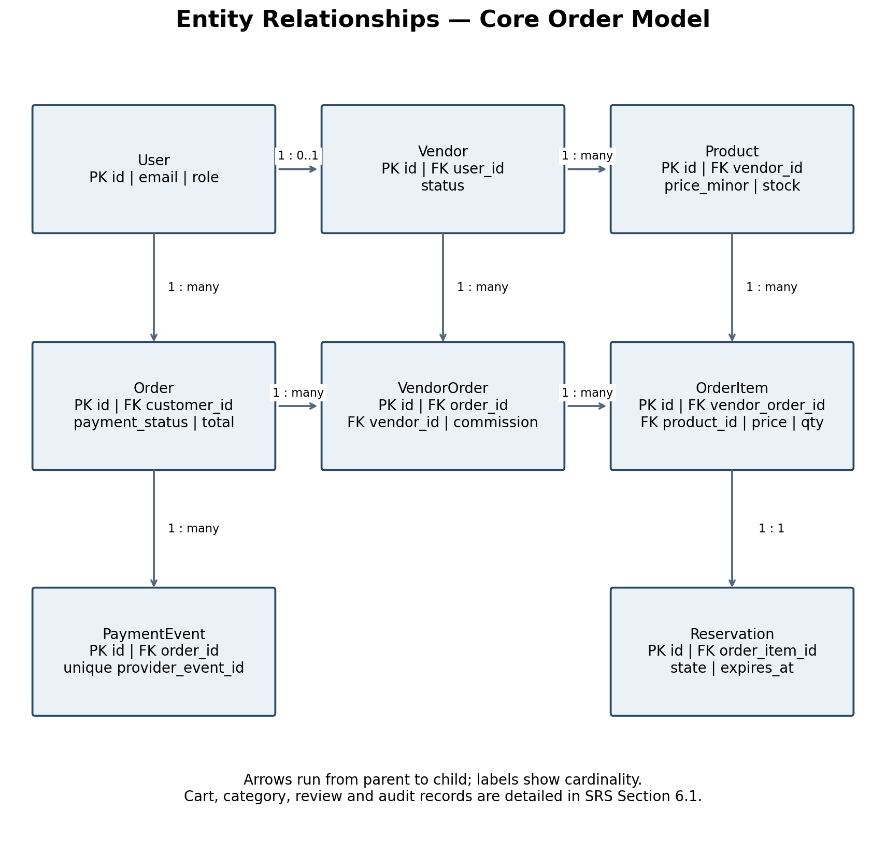
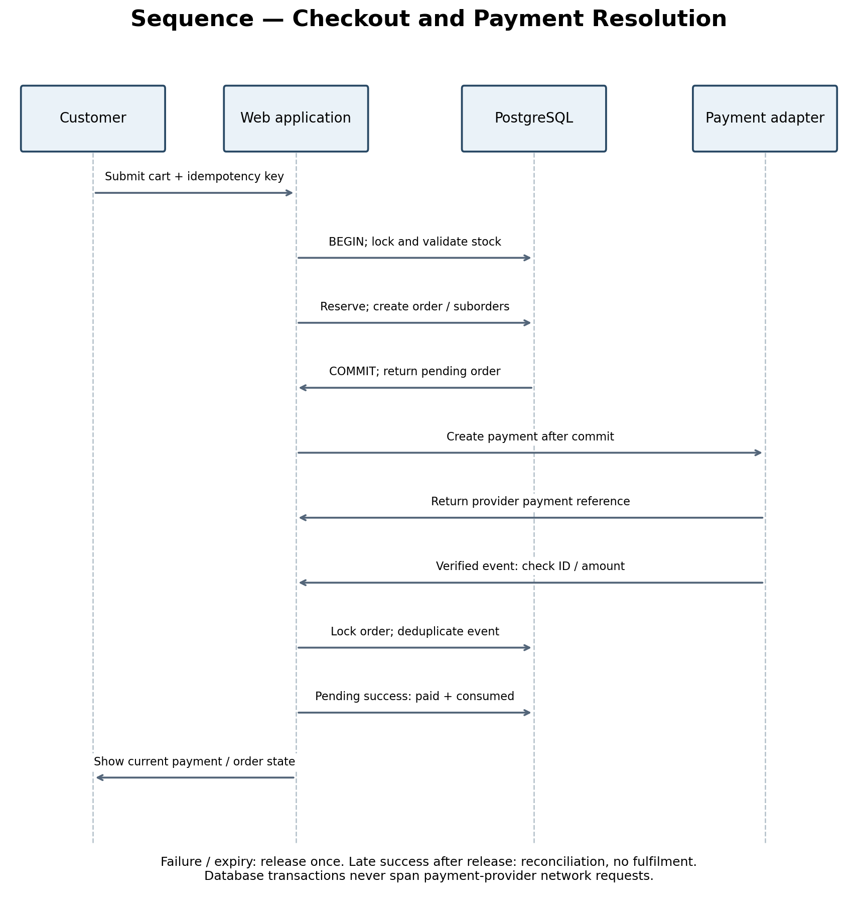

# Experiment 4
## Software Requirements Specification
**Course:** Software Design Principles (SDP)  
**Project:** Multi-Vendor E-Commerce Platform  
**Class / Section:** IT-B (2026-27)  
**Prepared by:** Keshav Garg  
**Roll Number:** 202401100600102  
**Repository:** https://github.com/KeshavGarg2570/2026-27_IT_B_202401100600102

## Aim
To prepare a structured SRS defining the external behaviour, interfaces, quality requirements and analysis models of the Multi-Vendor E-Commerce Platform.
## Objectives
- Turn the requirements in Experiment 3 into a verifiable implementation contract.
- Specify system features, exceptions and marketplace business rules.
- Model data flow, use cases, entities and checkout event order.
## Introduction
This SRS is the initial design baseline for an academic prototype. It follows the section organisation used in the reference lab repository. Requirements describe planned behaviour and do not claim that the application has already been implemented or validated.
## Table of Contents
1. Introduction
2. Overall Description
3. External Interface Requirements
4. System Features
5. Other Nonfunctional Requirements
6. Other Requirements
7. Appendix A Glossary
8. Appendix B Analysis Models
9. Appendix C Open Decisions
## Revision History
| Version | Date | Author | Change |
|---|---|---|---|
| 0.1 | 29 October 2026 | Keshav Garg | Initial marketplace requirements and analysis models |
## 1 Introduction
### 1.1 Purpose
Specify a marketplace where approved vendors sell through a shared catalogue, customers place mixed-vendor orders and administrators govern access and reporting. The document guides implementation and acceptance testing.
### 1.2 Document Conventions
FR01–FR12 identify functional requirements; NFR01–NFR08 identify quality requirements; US01–US12 identify user stories. “Shall” denotes a required behaviour. “Target” denotes a criterion to be measured during validation. Monetary amounts use integer minor units in INR; rates use integer basis points.
### 1.3 Intended Audience and Reading Suggestions
Evaluators should review scope, requirements and analysis models. Developers should additionally review state transitions, data constraints and interfaces. Testers should use the traceability matrix to derive acceptance evidence. Vendors and customers should validate their corresponding workflows.
### 1.4 Product Scope
The first release covers account roles, vendor approval, product management, cart, stock reservations, simulated payments, orders, fulfilment, reviews and commission reporting. Production payments, vendor settlement, courier automation, refunds, partial cancellation and international commerce are excluded. Expiry or failure of an unpaid checkout remains in scope.
### 1.5 References
- Experiment_2.md: problem statement, scope and feasibility.
- Experiment_3.md: proposed requirements and user stories.
- Reference lab repository: https://github.com/IshwarRajChauhan/2026-27_IT-B_202401100600094 (structure reference only; marketplace content is independently prepared).
- Project repository: https://github.com/KeshavGarg2570/2026-27_IT_B_202401100600102
## 2 Overall Description
### 2.1 Product Perspective
The product is a new modular web application. Django templates serve the user interface; application modules own accounts, catalogue, checkout and fulfilment. PostgreSQL is the authoritative store. A payment adapter isolates the simulated provider from business logic so a sandbox integration can be added later without changing order ownership rules.
### 2.2 Product Functions
Customers browse and purchase; approved vendors maintain stock and fulfil suborders; administrators approve vendors, moderate products and view commission reports. Checkout snapshots prices, reserves inventory and separates each vendor's responsibilities.
### 2.3 User Classes and Characteristics
Customers require clear navigation and order history. Vendors require authenticated management screens and access only to their own data. Administrators have elevated privileges, with auditable actions. Registration shall never permit a user to self-assign administrator privileges.
### 2.4 Operating Environment
Proposed stack: Python 3.12 or later, Django, PostgreSQL, HTML, CSS and limited JavaScript. A modern browser and local development machine are sufficient for the prototype. PostgreSQL is required for concurrency acceptance tests; SQLite shall not be used to claim row-lock correctness.
### 2.5 Design and Implementation Constraints
Use a modular monolith, not distributed services. Keep secrets outside source control. Use fictional test customers and products. The current repository contains documentation and a starter entry point only; application dependencies and deployment configuration will be added when implementation begins.
### 2.6 User Documentation
The README provides repository setup and current status. Later release documentation shall include customer checkout steps, vendor listing and fulfilment instructions, administrator approval steps and a backup restoration procedure.
### 2.7 Assumptions and Dependencies
All prototype amounts are INR. Shipping charge, discount and tax calculation are zero in the first test release and must be visibly labelled as demo assumptions. Commission applies to product subtotal only. Pending reservations expire after a configurable interval, initially 15 minutes. A scheduler will be required to release expired reservations; a reconciliation process will handle late events.
## 3 External Interface Requirements
### 3.1 User Interfaces
Customer screens: catalogue, product detail, cart, address confirmation, checkout result, order history and suborder tracking. Vendor screens: application status, own products, stock editor and own suborders. Admin screens: vendor approvals, listing moderation, audit history and commission reports. All actions require useful error messages and accessible form labels.
### 3.2 Hardware Interfaces
No specialised hardware is required. A browser communicates with the web server; the server accesses a database. File upload limits for product images shall be configured and validated on the server.
### 3.3 Software Interfaces
Modules access PostgreSQL through the Django ORM and explicit transaction boundaries. A payment adapter exposes create_payment, retrieve_status and verify_event operations. Payment events include a unique provider event ID, order reference, amount, currency and status. Amount and currency must match the stored order before any paid transition.
### 3.4 Communications Interfaces
Deployed traffic shall use HTTPS. Session cookies shall be secure and HTTP-only in deployment; state-changing browser requests shall use CSRF protection. A future provider webhook must verify its signature using a configured secret and deduplicate verified event IDs. The prototype must never collect card numbers or CVV.
## 4 System Features

### 4.1 Accounts and Vendor Approval
Priority: High.

Stimulus and response: A user registers as a customer or applies as a vendor. An administrator reviews the application.

Functional requirements: FR01, FR02.

Required behaviour and exceptions: Reject invalid credentials with a generic message. Pending or suspended vendors cannot sell; suspension must not hide existing customer order history. Existing paid suborders require administrator-managed resolution.

### 4.2 Catalogue and Discovery
Priority: High.

Stimulus and response: An approved vendor submits a listing. Customers search published products.

Functional requirements: FR03, FR04.

Required behaviour and exceptions: Validate price, stock, category and image input. Reject cross-vendor edits. Deactivate listings instead of deleting purchased item history.

### 4.3 Cart and Atomic Checkout
Priority: High.

Stimulus and response: The customer submits a cart and address with an idempotency key. The server creates a pending order.

Functional requirements: FR05, FR06.

Required behaviour and exceptions: Revalidate listings and lock stock rows in a stable product-ID order. If any item fails, roll back the complete checkout. Deduct available stock as a reservation and create parent order, vendor suborders, item snapshots and reservation records together. Commit before calling a payment service; never hold database locks during a network call.

### 4.4 Payment and Reservation Lifecycle
Priority: High.

Stimulus and response: The adapter reports success, failure or an unresolved payment; a scheduled task checks expiry.

Functional requirements: FR07.

Required behaviour and exceptions: Verified success atomically marks a pending order paid and reservations consumed. Failure or expiry releases reserved quantities exactly once. Payment success racing with expiry must lock the same order record. A late success after release creates a reconciliation flag and must not permit fulfilment or subtract stock again. Repeated checkout and callback keys return the existing result.

### 4.5 Order Access and Fulfilment
Priority: High.

Stimulus and response: A customer views their order. Each vendor processes their own paid suborder.

Functional requirements: FR08, FR09.

Required behaviour and exceptions: Enforce ownership on every request. Only paid suborders can progress through processing, shipped and delivered. Invalid backward transitions are rejected. Parent fulfilment summary is derived from all suborders, so one delivery never implies every vendor has delivered.

### 4.6 Commission Reviews and Administration
Priority: Medium.

Stimulus and response: An administrator reviews paid-order commissions; a customer reviews a delivered item.

Functional requirements: FR10, FR11, FR12.

Required behaviour and exceptions: Store the commission-rate snapshot per suborder. Round commission to the nearest paisa using half-up rounding. Historical rates and item prices remain immutable. Restrict reviews to delivered order items and record moderation and status actions in an audit log.

### 4.7 Functional Requirement Baseline
| ID | Feature | Required behaviour |
|---|---|---|
| FR01 | Accounts and roles | The system shall authenticate customers, vendors and administrators and enforce permissions on the server. |
| FR02 | Vendor approval | Only an administrator shall approve or suspend a vendor; unapproved or suspended vendors shall not receive new purchases. |
| FR03 | Catalogue ownership | An approved vendor shall create, edit and deactivate only its own products; price and stock shall be validated. |
| FR04 | Product discovery | Customers shall search active approved listings and filter by category and price. |
| FR05 | Cart | Customers shall add, change and remove positive integer quantities from several vendors; totals shall be calculated on the server. |
| FR06 | Atomic checkout | Checkout shall revalidate prices, approval and stock, reserve inventory and create one parent order with one suborder per vendor atomically. |
| FR07 | Payment state | The payment adapter shall support pending, paid, failed and expired states; duplicate events shall not repeat side effects. |
| FR08 | Order visibility | A customer shall see only their own orders; each vendor shall see only their own suborders and fulfilment-relevant address data. |
| FR09 | Fulfilment | The owning vendor shall move paid suborders through processing, shipped and delivered in order. |
| FR10 | Commission reporting | The system shall snapshot the commission rate and amounts at checkout and report commissions on paid orders without executing payouts. |
| FR11 | Verified reviews | A customer shall review a purchased product only after delivery, with at most one review per order item. |
| FR12 | Moderation and audit | Administrators shall moderate listings and review audit entries recording approval, suspension and fulfilment changes. |
## 5 Other Nonfunctional Requirements
### 5.1 Performance Requirements
Target p95 under 2 seconds for catalogue responses with 1,000 products and 20 concurrent users on the documented test environment; external payment latency is excluded.
Record hardware, dataset size, concurrency and latency distribution with the result; the target is not a measured claim.
### 5.2 Safety and Data Integrity
Inventory shall not become negative. An unpaid or reconciliation-flagged suborder shall not ship. Payment failure must not lose the cart or obscure an existing order. The application shall use simulated payment data only in demonstrations.
### 5.3 Security and Privacy
All protected operations must pass role and resource-ownership tests; use framework password hashing, CSRF protection and HTTPS in deployment. Vendors may access only fulfilment-required customer information for their suborders; logs must exclude passwords, credentials and card data.
Apply ownership checks to list, detail, update and export routes. Sanitize untrusted product text, validate uploaded content and limit file size. Do not allow client totals, vendor identifiers or role fields to override server-authoritative records.
### 5.4 Software Quality Attributes
| ID | Attribute | Acceptance target |
|---|---|---|
| NFR02 | Integrity | In concurrency tests, inventory must never be negative and one idempotency key must create at most one checkout result. |
| NFR04 | Usability | A new user should complete a mixed-vendor sandbox purchase within five minutes during a recorded usability exercise. |
| NFR05 | Reliability | Payment retries and expiry retries must be idempotent; backup restoration must be demonstrated on a test database before release. |
| NFR06 | Maintainability | Separate account, catalogue, checkout and fulfilment modules; cover all FR IDs with documented acceptance tests. |
| NFR08 | Accessibility | Forms must have labels, keyboard-operable controls, visible focus and useful validation errors; manually test core workflows. |
### 5.5 Business Rules
- One parent order belongs to one customer and contains one vendor suborder per participating vendor.
- Order items preserve title, product ID, vendor ID, unit price and quantity at purchase time.
- Available stock decreases on reservation; payment consumes the reservation without another stock decrement.
- Failed or expired reservations restore stock exactly once. Late payment success requires reconciliation.
- Pending and suspended vendors cannot receive new purchases.
- Commission is calculated per vendor suborder: round_half_up(product subtotal × rate basis points / 10000). Vendor net equals subtotal minus commission.
- Parent payment status and per-vendor fulfilment status are separate. All suborders must be delivered before the parent summary shows delivered.
- Past paid orders keep their original commission rates even after an administrator changes the configured rate.
- Reviews require a delivered order item and a unique customer/order-item pair.
## 6 Other Requirements
### 6.1 Data Requirements
| Entity | Key fields | Constraints |
|---|---|---|
| User | id, email, password_hash, role | Unique email; role assigned under controlled rules. |
| Vendor | id, user_id, store_name, status | One owner account per vendor profile. |
| Category | id, name | Unique category name. |
| Product | id, vendor_id, category_id, title, price_minor, stock, active | Positive price; stock at least zero. |
| Cart and CartItem | cart customer_id; item product_id, quantity | Unique product per cart; quantity greater than zero. |
| Order | id, customer_id, payment_status, total_minor, idempotency_key, address_snapshot | Unique customer/idempotency_key pair. |
| VendorOrder | id, order_id, vendor_id, subtotal_minor, commission_minor, rate_bps, status | Unique order/vendor pair; immutable monetary snapshot. |
| OrderItem | id, vendor_order_id, product_id, title_snapshot, unit_price_minor, quantity | Quantity greater than zero; preserved after product deactivation. |
| Reservation | id, order_item_id, quantity, expires_at, state | One reservation per order item; reserved, consumed or released. |
| PaymentEvent | id, order_id, provider_event_id, amount_minor, currency, status | Unique provider event ID; verified amount and currency. |
| Review | id, order_item_id, customer_id, rating, comment | Unique order item; rating between 1 and 5. |
| AuditLog | id, actor_id, action, object_ref, timestamp | Append-only application access; no secrets in event details. |
### 6.2 Acceptance Test Traceability
| Test ID | Requirements | Expected evidence |
|---|---|---|
| AT01 | FR01; NFR01 | Invalid login fails; protected screens reject unauthenticated requests. |
| AT02 | FR02 | Pending vendor cannot sell; administrator approval enables eligibility. |
| AT03 | FR03, FR08; NFR01, NFR07 | Vendor A is denied Vendor B product and suborder read/update/export access. |
| AT04 | FR04, FR05; NFR03 | Filters and cart arithmetic work; catalogue load target measured. |
| AT05 | FR06; NFR02 | Mixed-vendor checkout creates one parent/two suborders; insufficient stock rolls back all writes. |
| AT06 | FR06, FR07; NFR02, NFR05 | Concurrent checkout for one unit permits only one reservation; duplicate keys return one order. |
| AT07 | FR07; NFR05 | Failure and expiry release once; duplicate or late events never enable invalid fulfilment. |
| AT08 | FR09 | Unpaid shipment rejected; per-vendor statuses progress independently. |
| AT09 | FR10 | Commission rounding and snapshots stay correct after a rate change. |
| AT10 | FR11 | Undelivered and duplicate reviews rejected. |
| AT11 | FR12 | Moderation hides listings, preserves order snapshots and writes audit entries. |
| AT12 | NFR04, NFR06, NFR08 | Usability walkthrough, keyboard checks and requirement-to-test review recorded. |
| AT13 | NFR05 | Test database backup successfully restored and record counts checked. |

These are planned acceptance tests, not executed test results. The starter repository includes a checklist in test/README.md.
### 6.3 Deployment and Recovery
Before a hosted release, configure secret management, HTTPS, allowed hosts, database backups, static and media storage, reservation expiry scheduling and payment reconciliation. Verify that repeated expiry jobs and recovery after an interrupted callback preserve stock and payment consistency.
## Appendix A Glossary
| Term | Meaning |
|---|---|
| Vendor | Approved independent seller on the marketplace. |
| Parent order | Customer-facing purchase containing one or more vendor suborders. |
| Vendor suborder | Items and fulfilment status for one vendor in a parent order. |
| Reservation | Stock held temporarily while payment is unresolved. |
| Idempotency | Repeated requests have the same effect as one accepted request. |
| Basis point | One hundredth of a percentage point; 1000 basis points equals 10 percent. |
| Reconciliation | Resolve payment events that conflict with the local order state. |
## Appendix B Analysis Models
The diagrams describe the proposed system. The ER diagram is a core relational overview; cart, review and audit constraints are detailed in Section 6.1.

### Model 1 Context Level Data Flow Diagram

### Model 2 Level 1 Data Flow Diagram

### Model 3 Use Case Diagram

### Model 4 Entity Relationship Diagram

### Model 5 Checkout Sequence Diagram

## Appendix C Open Decisions
- Confirm remaining team member names, roll numbers and module assignments.
- Validate proposed requirements through stakeholder interviews and walkthroughs.
- Select hosting, payment sandbox provider and production data retention policy before deployment.
- Agree a refund and partial cancellation policy before accepting real payments.
- Confirm release workload, test environment and evaluation dates with the faculty.
## Observation
Explicit state transitions and immutable financial snapshots make marketplace requirements testable. Modelling payment, stock reservations and vendor fulfilment separately prevents several common consistency errors.
## Result
The initial SRS, functional baseline, quality targets, data model and acceptance-test mapping have been prepared for implementation and stakeholder review.
